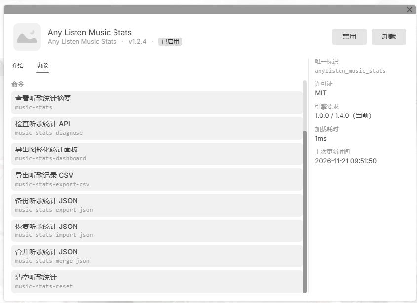
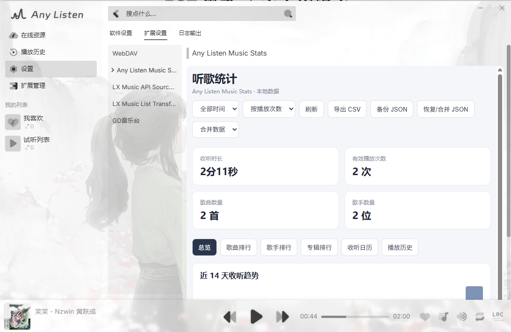
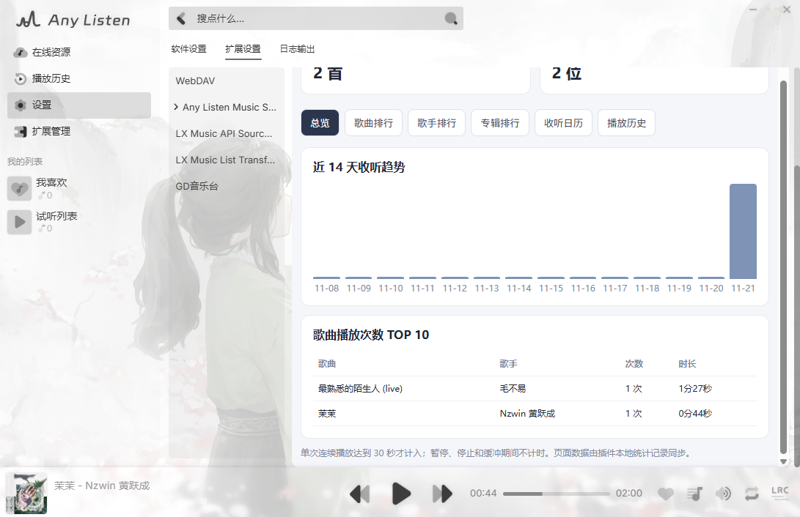

# Any Listen Music Stats

一个面向 **Any Listen 桌面音乐播放器** 的第三方本地听歌统计扩展项目。

## ⚠️ 重要免责声明

> **本项目全程由 AI 构建生成，未经过专业安全审计与完整测试流程。**
> 
> 可能存在严重漏洞、Bug、数据丢失风险、兼容性问题或未预期的行为。**请务必谨慎使用，生产环境或重要数据场景下建议先在测试环境验证。**
> 
> 使用即表示您理解并接受上述风险。如因使用本扩展导致任何数据损坏、软件异常或其他损失，作者不承担任何责任。

## 项目简介

**Any Listen Music Stats** 是一个为 Any Listen 桌面端音乐播放器开发的听歌统计扩展。它在本地记录你的播放历史，生成图形化统计面板，支持数据导出、备份与恢复，帮助你了解自己的听歌习惯。

- **完全本地运行**：所有数据仅保存在你的电脑上，不上传任何服务器
- **无需注册账号**：开箱即用，保护隐私
- **开源透明**：核心逻辑可审计，无隐藏行为

## 核心功能

### 图形化统计面板
- **KPI 概览**：累计收听时长、有效播放次数、歌曲数量、歌手数量
- **14 天收听趋势**：可视化展示近两周的听歌走势
- **TOP 100 排行**：歌曲、歌手、专辑三个维度的热门榜单
- **12 周收听日历**：类似 GitHub Contributions 的热力图，一眼看清活跃度
- **播放历史明细**：每一条有效播放记录的详细时间轴

### 灵活的筛选与排序
- **时间范围**：全部、今天、本周、本月、今年
- **排序方式**：按播放次数排序、按收听时长排序

### 完整的数据管理
- **CSV 导出**：听歌明细导出为 Excel 可打开的 CSV 文件
- **JSON 备份**：完整统计数据备份为 JSON 文件
- **JSON 恢复**：从备份文件恢复数据（覆盖模式）
- **JSON 合并**：将备份数据与现有数据智能合并（去重、取最大值）
- **格式兼容**：自动识别并兼容数组格式和对象格式的 tracks/sessions 数据

### 统计规则（公开透明）
- **有效播放判定**：单次连续播放达到 **30 秒** 才计入统计
- **暂停/缓冲不计时**：暂停、停止、缓冲期间的时间不计入有效时长
- **切歌/结束自动保存**：歌曲切换或自然结束时自动最终化当前记录
- **启动同步**：插件启动时自动同步正在播放的曲目
- **数据持久化**：所有数据保存在本地 `music-stats/data-v2.json`，兼容旧版数据迁移

## 界面预览

### 扩展安装界面


### 扩展功能列表


### 图形化统计面板 - 概览与趋势


### 图形化统计面板 - 排行榜与日历


## 当前稳定版本

| 项目 | 值 |
|------|-----|
| **稳定基线版本** | **v10** (AnyListen-beta5-MusicStats-Dashboard-Fix-v10) |
| **适配宿主版本** | Any Listen Desktop 0.10.1-beta.5 |
| **插件版本** | 1.2.4 |
| **扩展包文件** | `anylisten_music_stats_v1.2.4.alix` |
| **发布日期** | 2026-11-21 |
| **验证状态** | ✅ 用户实机测试通过，所有功能正常 |

> **重要说明**：v10 是目前唯一经过用户实机验证的稳定版本。后续版本（v11+）将在完成宿主差异审计、最小化补丁迁移、代码质量检查、用户实测验收后才会发布。

## 支持的 Any Listen 版本

| Any Listen 版本 | 适配状态 | 备注 |
|-----------------|----------|------|
| 0.10.1-beta.5 | ✅ 稳定基线 (v10) | 当前唯一验证通过的版本 |
| 1.1.3 | 历史版本 | 项目历史中曾适配，非当前基线 |
| 1.2.0+ | 待适配 | 需遵循版本工作流进行差异审计后适配 |

## 安装教程

### 前置要求
- Windows 10/11
- Any Listen Desktop 0.10.1-beta.5（当前稳定基线对应版本）
- 已安装 Node.js（用于构建插件包）

### 步骤一：替换宿主 app.asar (必须，高风险操作，请谨慎操作)

> ⚠️ **必须步骤**：扩展功能依赖宿主层面的 Dashboard 页面注入与 Player API 暴露，**必须替换 `app.asar` 才能使用本扩展的统计面板功能**。
> 
> ⚠️ **高风险操作**：替换宿主核心文件可能导致 Any Listen 无法启动、数据丢失或其他不可预期问题。请务必先完整备份原版 `app.asar`，并确认您具备恢复能力。

1. **完全退出 Any Listen**，并在任务管理器确认进程已结束。
2. **备份** 安装目录下的 `resources/app.asar`（例如重命名为 `app.asar.before-v10.bak`）。
   - 默认路径：`C:\Program Files\Any Listen\resources\app.asar`
3. 从 Release 下载 `AnyListen-beta5-MusicStats-Dashboard-Fix-v10.app.asar`，**重命名为 `app.asar`** 后替换安装目录下的 `resources/app.asar`。
4. **保留用户数据目录**，不要删除统计数据库（`music-stats/data-v2.json`）。
5. 重启 Any Listen，在设置中进入"听歌统计"面板查看图形化统计界面。
6. 如果仍无法启动，**立即退出并恢复备份**的原版 `app.asar`。
7. **本文件需要使用对应版本的软件**：Any Listen 0.10.1-beta.5。

### 步骤二：安装扩展包 (必须，配合步骤一使用)

> ⚠️ **必须步骤**：完成步骤一替换 `app.asar` 后，**必须安装本扩展包** 以启用统计记录、数据管理、导入导出等核心功能。仅替换 `app.asar` 无法记录播放数据。

1. 从 [Releases](https://github.com/mocho2001/anylisten-music-stats-public/releases) 下载 `anylisten_music_stats_v1.2.4.alix`
2. 打开 Any Listen，进入 **设置 → 扩展**
3. 点击 **从本地安装**，选择下载的 `anylisten_music_stats_v1.2.4.alix` 文件
4. 安装完成后，在设置 → 扩展设置中找到 **AnyListen-Music-Stats** 即可看到图形化统计界面

### 方法二：从源码构建（开发者/高级用户）
```powershell
# 1. 克隆仓库
git clone https://github.com/mocho2001/anylisten-music-stats-public.git
cd anylisten-music-stats-public/plugin

# 2. 配置签名密钥（首次构建需要）
copy .env.example .env
# 编辑 .env，填入你的 PRI_KEY (PKCS8 私钥) 和 PUB_KEY (SPKI 公钥 Base64)

# 3. 构建
.\build.ps1
# 产物在 plugin/dist/ 或 plugin/build/ 目录下
```

> ⚠️ **注意**：构建产生的 `.alix` 包含签名，必须使用与 Any Listen 扩展系统匹配的密钥对。如果没有密钥，请使用步骤二的预构建包。

## 使用教程

### 打开统计面板
1. Any Listen 主界面 → **设置** → **扩展**
2. 找到 **Music Stats**，点击 **打开面板** 或 **设置**
3. 或直接在设置左侧菜单找到 **听歌统计**

### 查看统计数据
- **概览页**：KPI 卡片、14 天趋势、TOP 10 排行
- **排行榜**：切换 歌曲/歌手/专辑，支持 时长/次数 双排序
- **日历**：12 周热力图，点击某天查看当日明细
- **历史**：完整播放记录列表，支持时间范围筛选
- **趋势**：14 天收听时长/次数走势图

### 数据导出与备份
| 操作 | 说明 | 适用场景 |
|------|------|----------|
| **导出 CSV** | 听歌明细 → Excel 可读 | 数据分析、个人归档 |
| **导出 JSON** | 完整统计数据备份 | 迁移设备、定期备份 |
| **导出 HTML 面板** | 离线可查看的图形化报告 | 分享给他人、离线查看 |
| **导入 JSON（覆盖）** | 完全替换现有数据 | 换设备恢复、回滚误操作 |
| **合并 JSON** | 智能合并，去重取最大值 | 多设备数据汇总 |

### 重置数据
- 在面板中执行 **重置** 命令，输入 `RESET` 确认
- 会清空所有本地统计数据，**不可恢复**，请先备份

## 数据保存与隐私说明

| 数据类型 | 存储位置 | 说明 |
|----------|----------|------|
| 播放统计 | `%APPDATA%\Any Listen\music-stats\data-v2.json` | 本地文件，仅你可见 |
| 导出文件 | 用户自选目录 | 完全由你控制 |
| 网络请求 | **无** | 插件不发起任何网络连接 |

**隐私承诺**：
- ❌ 不收集任何个人信息
- ❌ 不上传听歌历史到任何服务器
- ❌ 不包含任何遥测、统计上报代码
- ✅ 完全离线运行，数据 100% 掌握在你手中

## CSV / JSON 格式说明

### CSV 导出字段
```
歌曲, 歌手, 专辑, 开始时间, 结束时间, 有效时长(秒)
```

### JSON 结构 (data-v2.json)
```json
{
  "version": 2,
  "tracks": {
    "key|id|name|singer": {
      "key": "key|id|name|singer",
      "id": "song_id",
      "name": "歌曲名",
      "singer": "歌手名",
      "album": "专辑名",
      "seconds": 3600,
      "plays": 50,
      "lastPlayed": 1700000000000
    }
  },
  "sessions": [
    {
      "key": "key|id|name|singer",
      "name": "歌曲名",
      "singer": "歌手名",
      "album": "专辑名",
      "startedAt": 1700000000000,
      "endedAt": 1700000180000,
      "seconds": 180
    }
  ],
  "totalSeconds": 720000,
  "validPlays": 1200
}
```

> **兼容性**：导入时自动兼容 `tracks` 为数组或对象、`sessions` 为数组或对象的旧格式。

## 常见问题 (FAQ)

**Q: 为什么我的播放没有被记录？**
A: 只有连续播放超过 30 秒才会被计为有效播放。暂停、缓冲、切歌前不足 30 秒的片段不会记录。

**Q: 切换电脑怎么迁移数据？**
A: 使用 **导出 JSON** 备份，在新电脑上 **导入 JSON（覆盖模式）** 恢复。或使用 **合并模式** 将多台设备数据汇总。

**Q: 卸载扩展会删除数据吗？**
A: 不会。数据保存在 Any Listen 的存储目录中，卸载扩展不删除数据。重新安装后数据仍在。

**Q: 支持网页版 / 手机版 Any Listen 吗？**
A: 目前仅支持 Windows 桌面版 Any Listen Desktop。

**Q: 为什么 Dashboard 打不开/显示空白？**
A: 请确认 Any Listen 版本为 0.10.1-beta.5。其他版本可能因宿主结构变化导致不兼容，需等待对应版本的适配发布。

**Q: 可以同时安装多个统计扩展吗？**
A: 不建议。不同扩展可能共用同一宿主组件，导致数据冲突或面板异常。

## 项目目录说明

```
AnyListen-Music-Stats-Public/
├─ README.md                 # 本文件
├─ LICENSE                   # MIT 许可证
├─ CHANGELOG.md              # 版本变更日志
├─ CONTRIBUTING.md           # 贡献指南
├─ SECURITY.md               # 安全报告
├─ .gitignore                # Git 忽略规则
│
├─ docs/
│  ├─ FEATURES.md            # 功能详细规格（基线文档）
│  ├─ INSTALLATION.md        # 安装指南（本文件安装章节的扩展版）
│  ├─ CONFIGURATION.md       # 配置说明
│  ├─ DATA-AND-PRIVACY.md    # 数据与隐私详细说明
│  ├─ FAQ.md                 # 常见问题
│  └─ COMPATIBILITY.md       # 兼容性与审计报告
│
├─ plugin/
│  ├─ src/
│  │  └─ index.ts            # 插件主入口源码
│  ├─ build.ps1              # 构建脚本
│  ├─ tsconfig.json          # TypeScript 配置
│  └─ README.md              # 插件开发说明
│
├─ host-patch/
│  ├─ README.md              # 宿主补丁说明
│  ├─ patches/               # 补丁差异文件（待补充）
│  └─ scripts/
│      └─ patch_host.py      # 补丁应用脚本
│
├─ assets/
│  ├─ screenshots/           # 界面截图（已包含 4 张预览图）
│  └─ images/                # 文档用图片
│
├─ releases/
│  └─ README.md              # 发布说明模板
│
└─ .github/
   ├─ ISSUE_TEMPLATE/        # Issue 模板
   └─ workflows/             # GitHub Actions
```

## 参与开发与问题反馈

### 报告 Bug / 提出建议
请在 [GitHub Issues](https://github.com/mocho2001/anylisten-music-stats-public/issues) 提交，建议包含：
- Any Listen 版本
- 操作系统版本
- 复现步骤
- 预期行为 vs 实际行为
- 相关日志或截图

### 贡献代码
1. Fork 本仓库
2. 创建特性分支：`git checkout -b feature/your-feature`
3. 提交变更：`git commit -m 'feat: add your feature'`
4. 推送分支：`git push origin feature/your-feature`
5. 发起 Pull Request

> ⚠️ **重要**：任何针对宿主补丁的修改必须遵循《版本工作流规范》，需经差异审计、最小化补丁、用户实测验收后才能合并。

### 开发环境搭建
参考 `plugin/README.md` 和 `docs/INSTALLATION.md`。

## 第三方项目免责声明

**Any Listen Music Stats 是第三方社区项目，与 Any Listen 官方无关。**

- 本项目不代表 Any Listen 官方立场
- 不保证与未来 Any Listen 版本兼容
- 使用本扩展产生的任何数据问题，使用者自行承担风险
- 请在重要数据变更前自行备份 `data-v2.json`

## 许可证说明

本项目采用 **MIT License** 开源协议。

> 📋 **许可证：MIT License**

完整许可证文本请见 [LICENSE](LICENSE)。

### 依赖许可证声明

本项目包含以下第三方依赖，其许可证与 MIT 兼容：

| 依赖 | 版本 | 许可证 | 兼容性 |
|------|------|--------|--------|
| `extension-kit` | ^1.x | **Apache-2.0** | ✅ 与 MIT 兼容 |
| `any-listen-extension-lx-api-source-loader` | ^1.x | **Apache-2.0** | ✅ 与 MIT 兼容 |
| `typescript` | ^5.x | **Apache-2.0** | 仅构建时依赖，不随产物分发 |

> **结论**：所有生产依赖均为 Apache-2.0，与 MIT 许可证兼容。MIT 许可证不要求衍生作品保持相同许可证，因此可正常分发。

### 许可证生效日期

2026-11-21

本许可证追溯适用于 `anylisten-beta5-v10-stable` 标签及之后的所有发布版本。

---

> ⚠️ **注意**：Any Listen 宿主程序为专有软件，**不包含在本仓库分发范围内**。本项目仅分发扩展源码、补丁脚本与文档。

---

**项目主页**：https://github.com/mocho2001/anylisten-music-stats-public  
**问题反馈**：https://github.com/mocho2001/anylisten-music-stats-public/issues  
**私有开发仓库**：mocho2001/anylisten-music-stats (Private)